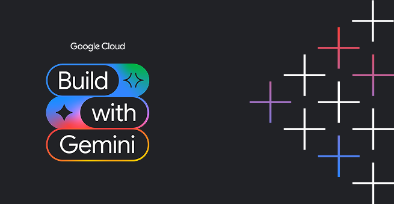

<div align="center">



# 🌿 Greenhouse Assistant (`greenhouse-agent`)

### An intelligent botanical and plant care conversational agent built on Google Cloud Agent Platform, ADK, and Gemini.

<br/>


<br/>


</div>

---

## 📖 Overview

**Greenhouse Assistant** is a specialized, agent-first application designed for gardening and indoor plant enthusiasts. It pairs Gemini generative intelligence with persistent cloud services, real-time climate telemetry, secure code execution, and structured A2UI display cards.

The agent helps users discover suitable indoor and outdoor plants, manage plant inventories, calculate scientific watering intervals tailored to specific pot materials and ambient temperatures, generate photographic plant visuals and time-lapse videos, and actively alerts users to plant allergen sensitivities (such as calcium oxalate crystal sap).

---

## 🚀 Key Capabilities & Implemented Features

Based strictly on the codebase implementation in `app/` and `agents-cli-manifest.yaml`, the agent provides:

- 🧠 **Cross-Session Long-Term Memory (Vertex AI Memory Bank)**:
  - Uses `PreloadMemoryTool` to load user history, preferences, and allergy details at session start.
  - Automatically persists conversation context and care logs after each turn via `after_agent_callback` (`add_session_to_memory`).
  - Active allergy safety warnings (e.g. skin irritation, toxic foliage, pollen allergies) before recommending plant care.

- 🗄️ **Live Database Operations (Google Cloud Firestore)**:
  - `list_plants`: Browses the `plants` collection with optional category filtering (`Foliage`, `Succulent`, `Tree`, `Flowering`).
  - `get_plant_details`: Queries detailed plant attributes (lighting, watering frequency, difficulty level, pricing, and stock status).
  - `add_or_update_plant`: Adds new plants or updates existing profiles directly in the database.

- 🧪 **Scientific Sandboxed Calculations (Agent Engine Code Executor)**:
  - Executes Python in a secure, isolated Agent Engine sandbox environment (`AgentEngineSandboxCodeExecutor`).
  - `calculate_watering_schedule`: Computes soil volume, evapotranspiration rates, and watering intervals based on pot diameter, ambient temperature, and container material (e.g. porous terracotta vs. glazed ceramic/plastic).

- ⛅ **Real-Time Climate & Solar Telemetry**:
  - `fetch_local_sunlight_and_climate`: Queries live temperature, relative humidity, UV index, and solar irradiance via Open-Meteo to assess indoor/outdoor lighting conditions.

- 🎨 **Visual Image & Video Generation (Cloud Storage + Omni Models)**:
  - `generate_plant_image`: Generates photorealistic visuals using `gemini-3.1-flash-lite-image` (global location), saves them to the session artifact store, and uploads them directly to Google Cloud Storage.
  - `generate_plant_video`: Generates short botanical videos and time-lapse clips using Google's Omni model (`gemini-omni-flash-preview`), saves to session artifacts, and uploads bytes to Cloud Storage.
  - Public Cloud Storage Bucket: Uploaded assets are hosted publicly at `https://storage.googleapis.com/<bucket>/...` for immediate rendering in user interfaces.

- 🪟 **Agent-to-UI Rendering (A2UI v0.8)**:
  - Employs `A2uiSchemaManager` with the Basic Catalog and `a2ui_callback` (`after_model_callback`).
  - Formats responses into structured UI components (`Card`, `Column`, `Row`, `Text`, `Image`) instead of markdown blobs.

- 🌐 **Web Chat Frontend**:
  - A FastAPI proxy server communicating directly over the Agent-to-Agent (A2A) JSON-RPC protocol (`message/send`).
  - Responsive, botanical-themed chat interface with example prompt pills and custom A2UI card renderer.

> [!NOTE]
> **Planned / Stretch Features (Not Yet Implemented)**:
> Automated hardware IoT soil moisture sensor webhooks and multi-user authentication are currently planned for future iterations.

---

## 🏗️ Architecture & Cloud Infrastructure

| Component | Service / Technology | Purpose |
|---|---|---|
| **Agent Core** | Google ADK + `gemini-3.8-flash` | Reasoning engine orchestrating function tools and prompt policies |
| **Long-Term Memory** | Vertex AI Agent Engine Memory Bank | Remembering user plant preferences and allergies across conversations |
| **Database** | Google Cloud Firestore | Structured database for plant species, inventory, and care requirements |
| **Object Storage** | Google Cloud Storage (GCS) | Public storage bucket for AI-generated plant photography and videos |
| **Code Sandbox** | Agent Engine Sandbox Code Executor | Isolated cloud execution for soil volume and watering calculations |
| **Media Models** | `gemini-3.1-flash-lite-image` & `gemini-omni-flash-preview` | Text-to-image and text-to-video generation |
| **UI Protocol** | A2UI (Agent-to-User Interface) v0.8 | Structured cards and layouts natively rendered in the frontend |
| **Web Proxy** | FastAPI + Uvicorn | A2A client proxy bridging browser chat requests to the agent |

---

## 🛠️ Local Development & Setup

### Prerequisites

- Python 3.11+
- [Google Cloud CLI (`gcloud`)](https://cloud.google.com/sdk/docs/install) authenticated with appropriate project permissions:
  ```bash
  gcloud auth login
  gcloud auth application-default login
  gcloud config set project <YOUR_PROJECT_ID>
  ```
- [UV package manager](https://github.com/astral-sh/uv) or standard Python `venv`
- `agents-cli` installed

### 1. Repository Setup

Clone the repository and navigate to the project directory:

```bash
git clone <YOUR_REPOSITORY_URL>
cd BuildWithGemini/greenhouse-agent
```

### 2. Install Dependencies

Install project dependencies using `uv` or `pip`:

```bash
pip install -r requirements.txt
```

### 3. Seed Firestore Database

Initialize the `plants` collection in Firestore with the default catalog:

```bash
python3 seed_firestore.py
```

### 4. Run the Agent Locally

You can launch the ADK Web development playground to test the agent interactively:

```bash
GOOGLE_GENAI_USE_VERTEXAI="true" \
GOOGLE_CLOUD_PROJECT="<YOUR_PROJECT_ID>" \
GOOGLE_CLOUD_LOCATION="global" \
uv run adk web . --reload_agents
```

### 5. Run the Custom Web Frontend

Navigate to the frontend directory and start the FastAPI web server:

```bash
cd frontend
pip install -r requirements.txt
uvicorn main:app --host 0.0.0.0 --port 8080
```

---

## 📦 Deployment

### Deploying the Agent to Agent Runtime

Deploy the agent logic to Google Cloud Agent Runtime using `agents-cli`:

```bash
cd greenhouse-agent
agents-cli deploy --project <YOUR_PROJECT_ID> --region us-east1 --no-confirm-project
```

### Deploying the Web Frontend to Cloud Run

Deploy the FastAPI proxy and static web UI to Google Cloud Run:

```bash
cd greenhouse-agent/frontend
gcloud run deploy greenhouse-frontend \
  --source . \
  --region us-east1 \
  --allow-unauthenticated \
  --set-env-vars A2A_ENDPOINT="<AGENT_RUNTIME_A2A_ENDPOINT>"
```

---

## 📄 License

This project is licensed under the Apache 2.0 License. See the LICENSE file for details.
